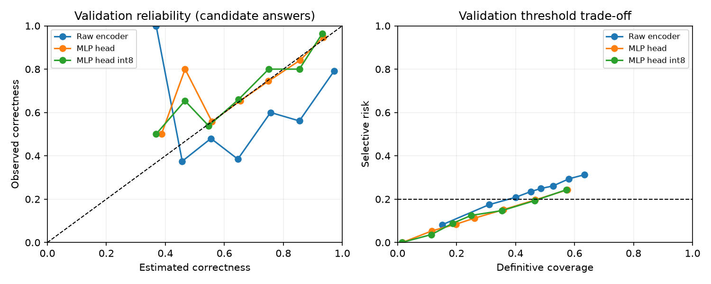

# HoundOracle campaign 01/02: measured results and execution limits

The baseline at `9123fdb` is preserved. This campaign adds benchmark instrumentation,
a pinned Vertex adapter, independent-label data preparation, trained aggregation
heads, scoped calibration, ONNX comparisons and reproducible artifacts. It does
**not** establish an advantage over Gemini or qualify a general-purpose release.

## Answers to the eight requested questions

| Question | Evidence-backed answer |
|---|---|
| 1. Cheaper than Gemini? | Unknown. No Gemini generation succeeded. All-in local compute/storage prices and invoices are unknown; zero external model calls is not zero operating cost. |
| 2. Faster than Gemini? | Unknown. The research FP32 MLP pipeline measured P50 **51.4 ms**, P95 **90.4 ms** on supplied historical evidence. This excludes live retrieval and agent execution. |
| 3. More accurate? | No comparative evidence. FP32 MLP accepted-answer correctness **85.4%**; four-label decision-match accuracy including abstentions **57.5%**. Gemini comparison remains blocked. |
| 4. Definitive and correct? | FP32 MLP: **185/600 (30.8%)** definitive, **158/600 (26.3%)** definitive and correct. Selective error **14.6%**, clustered 95% interval approximately **10.1–19.7%**. |
| 5. Central reuse economics? | Unmeasured: no S3 requests or index service ran. Exact local reuse measured about **0.055 ms P50**, versus **46.6 ms** cold on a separate repeated validation workload. The workload deliberately repeats questions; it is not a forecast of production hit rate. |
| 6. Improvements that helped? | Learned logistic/MLP heads improved held-out validation classification over the raw NLI encoder; dedicated calibration enabled scoped selective answers. Int8 reduced CPU latency but failed the repeated workload's quality/coverage adoption checks. |
| 7. NNUE/neural-guided search? | Not demonstrated or promoted. No real search trajectories were available; inference was dominated by the semantic encoder. No advanced search or incremental aggregator superiority claim is supported. |
| 8. Public release justified? | **No.** The Gemini comparison, live retrieval, broad domain coverage, independently re-audited citations, all-in costs and production calibration are missing. Definitive coverage is below the earlier 50% release gate. |

## Systems and measured heldout results

All configurations were frozen before running the 600-question evaluation once.
Models were not tuned on its results. The four trained-head configurations were
retained as a validation Pareto set; the raw encoders were negative controls.

| System | Definitive coverage | Correct definitive / all | Accepted correctness | P50 / P95 local pipeline |
|---|---:|---:|---:|---:|
| Production deterministic core, uncalibrated | 0% | 0% | undefined | 0.37 / 0.59 ms |
| Raw NLI plus calibration gate | 0% | 0% | undefined | 51.4 / 90.4 ms |
| FP32 NLI + logistic head | 26.5% | 22.8% | 86.2% | 51.4 / 90.5 ms |
| FP32 NLI + MLP head | 30.8% | 26.3% | 85.4% | 51.4 / 90.4 ms |
| Int8 NLI + logistic head | 34.5% | 28.8% | 83.6% | 34.4 / 63.2 ms |
| Int8 NLI + MLP head | 29.8% | 25.5% | 85.5% | 34.4 / 63.2 ms |

These are **historical evidence-conditioned** classifications, not complete live
AI-agent research workflows. Gold evidence was supplied to each research system.
No retrieval recall, search savings or complete workflow cost is inferred. The
production core lacks a compiler/source policy for most of these questions and
correctly abstains. Outperforming its coverage is not a competitive Gemini result.

The int8 logistic configuration has the largest coverage, but its heldout
selective-error interval extends to about **21.2%**. It is not promoted. The
repeated quantization experiment also showed a quality/coverage regression on its
fixed validation subset: about -3.3 percentage points in decision accuracy and
-5 percentage points in coverage. Its P50 speed improvement was about 33%; the
P95 improvement interval was wide (approximately 11–33%). This does not satisfy all
predeclared adoption conditions. FP32 MLP remains a useful research checkpoint;
production continues to use the preserved conservative core.

## Dataset, training and calibration

FEVER labels came from independent human annotations, cross-checked against the
official development file. The pinned gold-evidence mirror was checked for claim,
label and complete gold-set consistency. **117** incomplete evidence variants were
excluded; **6,052** repeated evidence variants were collapsed by original ID.
Original NOT ENOUGH INFO labels remain MAYBE, never refutation.

Initial variant-level sampling was invalidated after discovering duplicate IDs
and severe class skew. Its failures and original manifest are preserved. The final
partitions have 2,000 development, 480 validation, 1,200 calibration and 600 evaluation
examples. Shared evidence pages, subjects and claims define connected components.
Final evaluation excludes every component containing any question scored in the
invalidated run, as well as current development/validation/calibration components.
The final evaluation has 69 components. Residual event/paraphrase or pretraining
leakage cannot be ruled out. FEVER gold-label noise remains a limitation.

The encoder is `cross-encoder/nli-MiniLM2-L6-H768`, revision
`b95119ce93d3e065de6214e38cd4a97b0f2f2c6d`, CPU ONNX Runtime, one inference thread,
512-token limit. Float and published int8 files have recorded SHA-256 hashes.
No full encoder fine-tuning or generative-model training occurred. A five-feature
logistic head and a one-hidden-layer, 16-unit MLP were trained on development only.
Seed 1729; MLP learning rate .001, maximum 150 epochs. The optimizer reached its
iteration cap; the warning was retained, not treated as convergence. Checkpoints,
training losses, validation losses and timing are stored as safe JSON.

Calibration components are split into mapping-fit and untouched risk-check halves.
Temperature-style binary correctness scaling, logistic calibration and isotonic
regression were compared using validation Brier scores. Selection precedes the
independent risk check. The stopped, single-pass research policy requires a
candidate YES/NO, untruncated evidence, mapped correctness >=.80 and an empirical
clustered-row risk gate. It is not conformal or anytime-valid inference. Group-any-
error Clopper-Pearson bounds are reported separately; they do not certify arbitrary
row-weighted risk. The population is explicitly historical FEVER, not live-world
questions. Production calibration has not been silently replaced.

Citation consistency uses original complete annotation sets as a proxy. It is not
an independent second human audit of each generated verdict or a check of current
Wikipedia contents. Exact supporting text is preserved in the external raw records.
Required current technical/product facts, primary-record freshness, real conflicting
sources and adversarial web retrieval remain inadequately evaluated.

## Gemini execution and actual spending

The official page documents `gemini-3.8-flash` and LOW/MEDIUM/HIGH thinking.
The prepared adapter pins Google Gen AI SDK **2.34.0**, global inference,
temperature 0, seed 1729, 8,192 input / 4,096 output token envelopes and no automatic
retry. Introductory documented list prices were $0.75/$3.75 per million input/output
tokens through 2026-12-31. Reasoning tokens are counted in calculated output cost;
calculated list-price costs are kept separate from invoices and unknown host costs.
Grounding metadata is not mistaken for an authoritative billing export.

The user authorized a new **$3** matched-evidence pilot: at most 48 calls and one
10-minute CPU worker. Both attempted job submissions were rejected with HTTP 429
for `aiplatform.googleapis.com/custom_model_training_cpus`, in `us-central1` and
`us-east1`. No worker started and no generation ran. Model/training usage charges
for these experiments are **$0**; no billing-export verification is claimed.
Quota inspection was also unavailable, and the connector forbids its Cloud Shell
fallback. Credentials were not exported; no quota increase or API enablement was
attempted. The approved pilot does not authorize grounded inference.

A/B/E/F/G Gemini comparisons therefore remain unexecuted. Substituting a different
model would not solve the CPU execution quota issue. No Gemini-relative cost,
latency, accuracy, coverage or token-saving percentage is reported.

## Reproduce and continue

Install `uv sync --extra dev --extra api --extra mcp --extra s3 --extra benchmark`.
Follow `reproduction.md`; respect frozen partition and one-shot evaluation guards.
Raw source data, downloaded models and full question/citation traces remain under
`/workspace/houndoracle-data` and `/workspace/houndoracle-models`, outside the Apache
source distribution. Committed results contain IDs, outcomes and measurements.
Their source annotations retain separate attribution/share-alike rights.

The campaign stopped because critical Gemini execution evidence was unavailable,
a bounded local comparison was completed, and advanced candidates did not clear
all adoption conditions. This is not statistical convergence or a global optimum.
Next: obtain an authenticated Vertex execution environment or adequate training CPU
quota, resume the already authorized bounded pilot, then run a separately authorized
grounded/agent workflow comparison and add independent primary-record/current-data
cohorts. Do not spend on NNUE/search-policy training before these bottlenecks are
resolved. Existing products, OPS and public GitHub state were not modified.

Additional failure note: on the fixed repeated validation subset, FP32 MLP's
accepted error was 23.1%, despite lower aggregate error on the final cohort.
Calibration is not a per-question or every-subgroup guarantee. The aggregation
feature called evidence-group count in this experiment counts distinct supplied
Wikipedia pages; it does not prove independent upstream sources. Both issues are
reasons to retain the production source/provenance gates and expand evaluation.

## Subsequent authenticated Gemini execution

The earlier authentication/quota blocker above was resolved on 2026-11-15 using an authorized temporary Cloud Run CPU job. Actual Gemini 3.8 Flash results, including the tail-latency regression, are documented in [campaign 03](experiments/campaign-03/README.md). The earlier unavailable-comparison statement is historical; it is not the current execution status. This pilot does not establish full grounded-agent or all-in-cost superiority.

## Continued local optimization, 2026-11-16

[Campaign 04](experiments/campaign-04/README.md) measured bounded exact evaluator reuse and two-thread CPU inference improvements. The context-feature head was rejected for lower accuracy/coverage. These are local CPU results, not a new Gemini superiority claim. A fresh 48-question matched-evidence campaign is prepared and explicitly authorized up to $8; execution awaits connector reauthentication. Production/public release gates remain closed.

## Larger live comparison, 2026-11-16

The newly authorized $8 campaign executed on 48 fresh source-disjoint questions.
[Campaign05](experiments/campaign-05/README.md) reports 285 emitted results and three
failed/uncertain/unexecuted task slots, all preserved. The partial comparison shows
lower model-token cost and higher observed workflow accuracy/coverage, but latency
uncertainty still allows regression, coverage noninferiority is unestablished,
and all-in/grounded/current/agent benefits remain unmeasured. A provider deadline
and bounded worker timeout made the planned replication incomplete. The temporary
job is deleted. No production/public release gate is declared passed.
